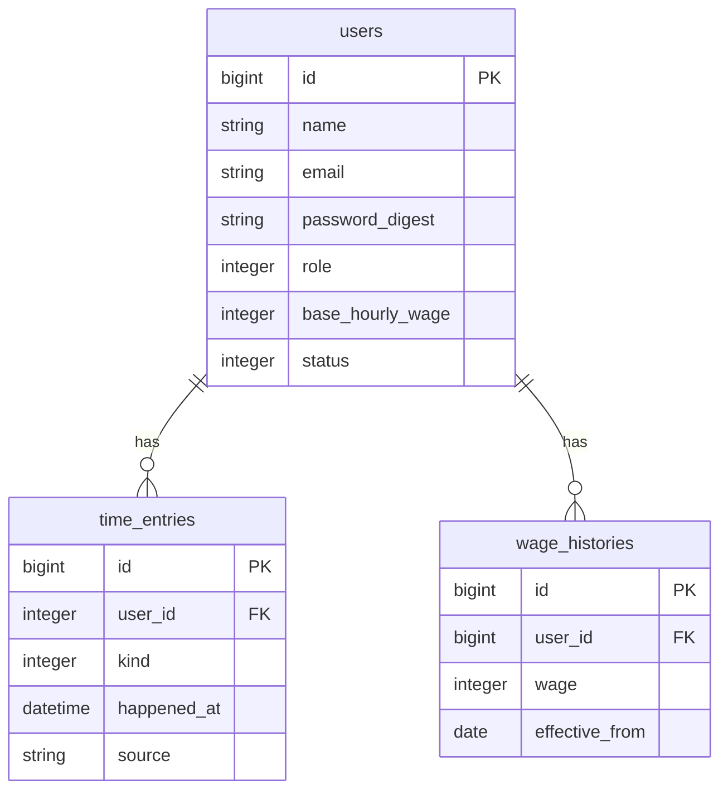
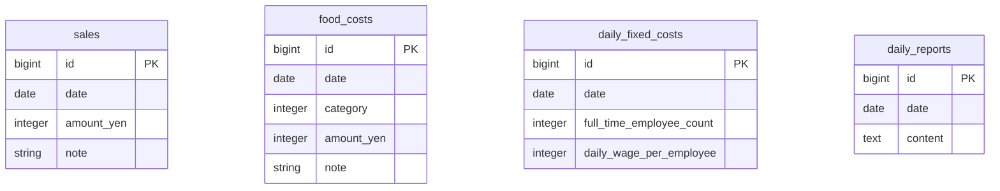
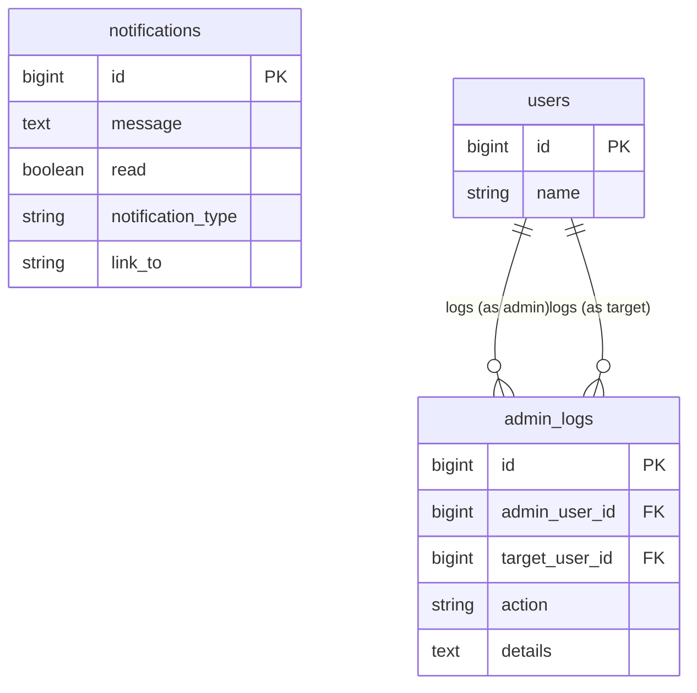

# FLan API

これは，飲食店のFL比率を管理するためのアプリケーションFLanのAPIです．

## 技術スタック

* **バックエンド:** Ruby on Rails 8.0.2 (APIモード)
* **データベース:** PostgreSQL

## 機能一覧

このアプリケーションは，飲食店の従業員と管理者のための2つの側面を持っています．

### 管理者向け機能
管理者は，店舗の経営状況の把握と従業員の管理を行うための全ての機能にアクセスできます．

- **日次・月次サマリーの閲覧**
  - 指定した日の売上、人件費、食材費、そして経営指標である**FL比率**を一覧で確認できます。
  - 月間の累計FL比率などを、前年同月のデータと比較しながら確認できます。

-   **経営データの管理**
    -   日々の売上を登録・更新できます。
    -   食材費をカテゴリ別に登録・更新できます。
    -   正社員の人数を管理できます。
    -   業務日報を作成・更新できます。

-   **従業員管理**
    -   従業員（ユーザー）の一覧表示、役割や時給などの情報更新ができます。
    -   従業員からの新規登録申請を承認できます。

-   **システム機能**
    -   自身を含め、他の管理者が行った操作のログを時系列で閲覧できます。
    -   新規ユーザー登録などの通知を確認し、既読にすることができます。

### 従業員向け機能

従業員は、自身の勤怠を管理するための基本的な機能にアクセスできます。

-   **勤怠打刻**
    -   出勤、退勤、休憩開始、休憩終了を打刻できます。

-   **ユーザー登録**
    -   システムにアカウントの利用申請を行えます（利用には管理者の承認が必要です）。

## アプリケーションのアーキテクチャ概要

このAPIは、**コントローラ**がAPIリクエストの受付と応答に徹し、複雑なビジネスロジックは**サービスクラス**に分離しています。

### Controllers (app/controllers)

コントローラはAPIのエンドポイントとして、クライアントからのリクエストを受け取り、適切なサービスクラスを呼び出して、結果をJSON形式で返却する役割を担います。

* **集計とサマリー (`DailySummaryController`, `MonthlySummaryController`)**
    * 各経営データを統合し、日次・月次のFL比率などを算出した経営サマリーを提供します。

* **経営データ管理 (`SalesController`, `FoodCostsController`, `DailyFixedCostsController`, `DailyReportsController`)**
  * 日々の売上、食材費、固定費、業務日報といった、経営分析の基礎となるデータの登録・更新・取得を担当します。

* **ユーザー認証・管理 (`AuthController`, `UsersController`)**
  * ユーザーの登録申請、ログイン認証 (JWT)、管理者による従業員情報の管理など、アカウントに関連する機能を提供します。

* **システム管理 (`AdminLogsController`, `NotificationsController`, `HealthChecksController`)**
  * 管理者向けの操作ログやシステム通知の管理、そしてアプリケーションの死活監視といった補助的な機能を提供します。

* **勤怠管理 (`Timeclock::TimeEntriesController`, `Attendance::DailyController`)**
  * 従業員による日々の出退勤や休憩の打刻、および勤務状況の確認を行います。

### Services (app/services)

アプリケーションの中核となる複雑な計算やビジネスロジックは、サービスクラスに集約されています。

#### 経営サマリー・勤怠計算

-   **`DailySummaryService` / `MonthlySummaryService`**: **このアプリケーションの心臓部です。** 売上、人件費、食材費など、複数のテーブルからデータを集計し、飲食店の重要な経営指標である**FL比率**を算出します。
-   **`Attendance::Calculator`**: 従業員の打刻記録から、実働時間、休憩、深夜労働時間などを正確に計算します。日次・月次サマリーの基礎となる重要なロジックです。
-   **`Payroll::Calculator`**: 勤怠情報と時給を元に、深夜割増を含めた日給を計算します。

#### データ登録・更新処理

-   **`UpsertFoodCostsService`**: 日々の食材費データを一括で登録・更新します。過去のデータを一度削除してから新しいデータを作成し、差分をログに記録します。
-   **`UserApprovalService`**: 管理者が新規ユーザーを承認する際の処理を担当します。ユーザーステータスの更新、時給履歴の作成、操作ログの記録といった一連のタスクをトランザクション内で実行します。
-   **`UserUpdateService`**: 管理者が既存ユーザーの情報を更新する際の処理を担当します。権限や時給の変更を検知し、差分があった場合のみ時給履歴や操作ログを更新します。

## ER図

### ユーザー関連

### 日次データ関連

### システム・ログ関連

